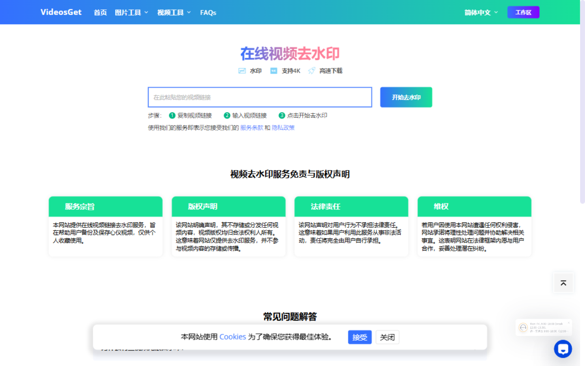
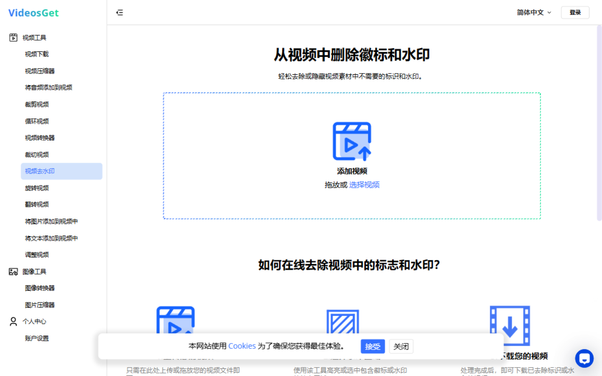
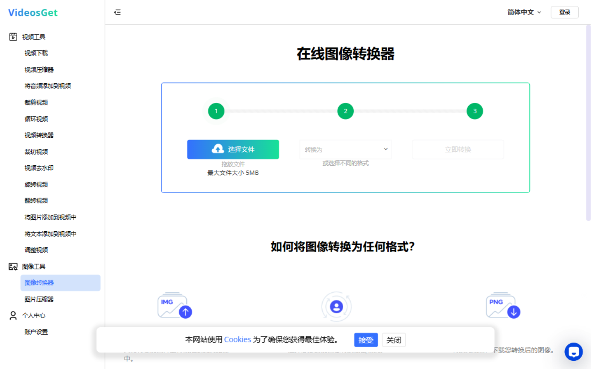

# VideosGet Toolkit · 视频图片在线工具箱 Skill

一个把 [VideosGet](https://www.videosget.com/)（www.videosget.com）完整封装成 AI Agent Skill 的项目。装上之后，AI 助手就能自动路由到正确的工具页面，指导（或代替）你完成**视频去水印下载、视频剪辑处理、图片格式转换压缩**等一整套媒体任务——手机、电脑、平板浏览器都能用，全程免安装。



## 网站能力一览

**首页核心功能：视频链接解析 + 去水印下载**，三步搞定：

1. 复制视频链接
2. 粘贴到首页输入框
3. 点击「开始去水印」→ 得到无水印视频（支持 4K、高速下载）



**在线编辑工具（14 个）**：上传文件 → 设参数 → 下载结果，浏览器内完成：

| 类别 | 工具 |
| --- | --- |
| 视频 | 压缩、格式转换、加音频、裁剪时长、裁切画面、循环、去 Logo 水印、旋转、翻转、加图片（贴 Logo）、加文字、调尺寸 |
| 图片 | 格式转换（HEIC/PNG/WebP/JPG/SVG/GIF）、图片压缩 |



## Skill 里包含什么

```
videosget-skill/
├── SKILL.md            # Skill 主文件：任务→链接路由表 + 操作流程 + 团队创作规范
├── references/
│   └── tools.md        # 14 个工具的完整参考（功能、路径、语言路由、FAQ 速查）
└── assets/
    ├── home.png        # 网站截图：首页（视频去水印）
    ├── video-remove-logo.png  # 网站截图：视频去水印工具
    ├── image-converter.png    # 网站截图：图像转换器
    └── logo.png        # 团队视频 Logo（做视频时叠加使用）
```

### 内置团队创作规范

Skill 中固化了两条工作流规则，AI 处理视频任务时会自动遵守：

1. **视频 Logo**：优先使用 `assets/logo.png`（通过"加图片到视频"工具叠加），也支持按品牌风格自行设计；
2. **发布前审核**：视频成品和脚本**必须先提交审核，通过后才能发布**，AI 不会默认直接发布。

## 安装

### Claude Code / ZCode 等 Agent CLI

```bash
# 全局安装（所有项目可用）
git clone https://github.com/kylin-feng/videosget-skill.git \
  ~/.agents/skills/videosget-toolkit
```

或手动把本仓库放到你的 skills 目录下（如 `~/.agents/skills/` 或 `~/.claude/skills/`），目录名保持 `videosget-toolkit` 即可。

## 使用示例

装好后直接用自然语言吩咐，例如：

- 「帮我把这个抖音链接去水印下载下来」
- 「把这个 MOV 视频转成 MP4」
- 「iPhone 拍的照片是 HEIC，帮我批量转 JPG」
- 「给这条视频加上我们的 logo，再压缩到 50M 以内」
- 「这段视频太长了，掐头去尾只留中间 30 秒」

AI 会自动打开对应工具页（或把直达链接发给你），并按团队规范处理 logo 和提醒审核。

## 直达链接速查

| 任务 | 链接 |
| --- | --- |
| 视频去水印下载 | <https://www.videosget.com/zh> |
| 视频压缩 | <https://www.videosget.com/workspace/video-compressor/zh> |
| 给视频加音频 | <https://www.videosget.com/workspace/video-merger/zh> |
| 视频格式转换 | <https://www.videosget.com/workspace/video-converter/zh> |
| 裁剪时长 | <https://www.videosget.com/workspace/video-trim/zh> |
| 裁切画面 | <https://www.videosget.com/workspace/crop-video/zh> |
| 循环视频 | <https://www.videosget.com/workspace/video-loop/zh> |
| 去 Logo（本地上传） | <https://www.videosget.com/workspace/remove-logo-video/zh> |
| 旋转视频 | <https://www.videosget.com/workspace/rotate-video/zh> |
| 翻转视频 | <https://www.videosget.com/workspace/flip-video/zh> |
| 加图片/贴 Logo | <https://www.videosget.com/workspace/add-image-to-video/zh> |
| 加文字 | <https://www.videosget.com/workspace/add-text-to-video/zh> |
| 调整尺寸 | <https://www.videosget.com/workspace/resize-video/zh> |
| 图片格式转换 | <https://www.videosget.com/workspace/image-converter/zh> |
| 图片压缩 | <https://www.videosget.com/workspace/image-compressor/zh> |

> 💡 把链接末尾的 `/zh` 换成 `/en`、`/ja`、`/ko` 等，可切换 24 种语言界面。

## 说明

- 本仓库只是 VideosGet 网站的使用 skill 封装，所有处理能力均在官网完成，网站不存储、不分发任何视频内容；
- 解析下载的视频版权归原权利人所有，仅供个人收藏备份等合法用途；
- 官方文档：[FAQ](https://www.videosget.com/faq/zh) · [服务条款](https://www.videosget.com/about/terms/zh) · [隐私政策](https://www.videosget.com/about/privacy-policy/zh)

## License

[MIT](LICENSE)
